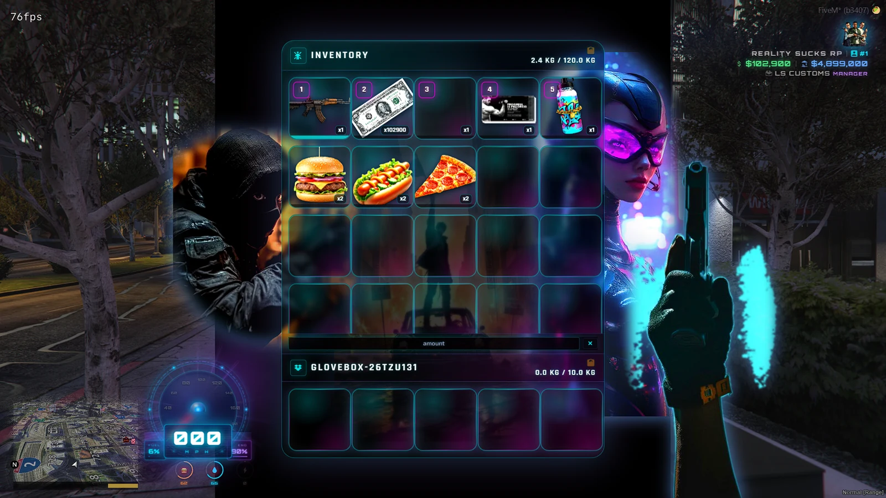

# RS Punk Inventory

<a href="https://reality-sucks-rp-webstore.tebex.io/package/7449247"></a>

Put your server identity inside the inventory. Neon artwork and custom branding pair with physical cash, HUD synchronization, weapons, floor drops, vehicle storage and player transfers. Server-authoritative updates and drop reconciliation help keep the menu connected to actual inventory state.

[Download the original ZIP](https://github.com/RealitySucksRP/qb-inventory-reworked-images-in-menu/releases/latest/download/qb-inventory-punk.zip) | [Free on Tebex](https://reality-sucks-rp-webstore.tebex.io/package/7449247) | [Website](https://realitysucksrp.github.io/) | [Discord](https://discord.gg/e9V3rPHySx) | [YouTube](https://www.youtube.com/@RealitySucksRP) | [All free scripts](https://reality-sucks-rp-webstore.tebex.io/category/free-scripts)

**Install folder:** `qb-inventory`. Download the original ZIP to retain the package folder layout. Source, configuration, licenses and included assets are provided below.


## Package documentation

# qb-inventory - RealitySucksRP Punk Edition

> Install this resource with the folder name `qb-inventory`.

RS Punk qb-inventory `3.0.5-rs-punk-production-guard` keeps the supplied Punk menu/UI style while sharing the hardened QBCore inventory backend used by its sibling build.

## Scope

This build is intentionally focused on **QBCore + qb-inventory**. It does not add Qbox, ESX, Standalone, or an external adapter dependency.

## Core features

- Server-authoritative inventory sessions and secondary-inventory access checks.
- Player inventory, stashes, shops, vending, trunks, gloveboxes and floor drops.
- Server-validated player search/robbery flow with mutual locks and server-enforced search duration.
- Vehicle sessions retain the verified network id/plate/type/routing bucket and revalidate the same vehicle throughout the session.
- Floor drops are server-created/tracked, routing-bucket aware, carry-safe and cleaned on resource stop.
- Weapon inspection and detachable attachment panel.
- Expiry/decay-aware item handling and configurable expiry stacking.
- Cash-as-item synchronization, death/last-stand protection and `/cashcheck` support.
- Debounced persistence for dirty stash/trunk/glovebox state.
- Local Vue/Axios/Floating UI/Font Awesome runtime dependencies and bundled Punk fonts; the active NUI does not require a CDN.

## Required resources

- `qb-core`
- `qb-weapons`
- `oxmysql`
- `qb-target`
- OneSync/state awareness (required by the manifest)

The included `REQUIRES_QB_WEAPONS_PATCH.md` documents the qb-weapons compatibility edits required for attachment removal. Cash-as-item is enabled in this Punk build; retain/apply the qb-core cash integration described in `docs/qb-core-cash-as-item.md`. Before enabling any death, zombie, medical, hardcore, or respawn-loss resource, read `SERVER_OWNER_COMPATIBILITY_NOTES.md`.

## Install

1. Back up your current inventory resource.
2. Replace it with this build and keep the folder name exactly `qb-inventory`.
3. Ensure OneSync/state awareness is enabled.
4. Start dependencies before/with qb-inventory:

```cfg
ensure qb-core
ensure oxmysql
ensure qb-target
ensure qb-weapons
ensure qb-inventory
```

5. Keep the existing RS Punk qb-core cash patch if you use physical cash.
6. Import `qb-inventory.sql` only for a fresh install; use `migrate.sql` when migrating legacy inventory tables.
7. Apply the separate qb-weapons attachment patch in `REQUIRES_QB_WEAPONS_PATCH.md`.

## Important preserved settings

This Punk build intentionally keeps:

```lua
Config.CashAsItem = true
Config.CustomHUD.Enabled = true
```

The HUD hook is guarded by resource-state/export error handling, so servers without that HUD should disable or repoint it rather than adding a hard dependency.

## Security model

Every important item mutation is validated against server-owned state. The server decides what inventory the player has open, revalidates distance/routing bucket/vehicle/drop/player context, bounds slots and amounts, and serializes competing mutations with per-player locks.

Legacy client-triggerable grant/open paths remain closed by default:

- `QBCore:Server:AddItem`
- `QBCore:Server:RemoveItem`
- `inventory:server:OpenInventory`

Server resources should use the qb-inventory exports instead of triggering those net events from clients.

Additional production guards include:

- active-session watchdogs and forced close when authorization is lost;
- server-owned `inv_busy` state rather than client writes;
- source-id cleanup on raw `playerDropped`, independent of QBCore unload ordering;
- server-timed robbery completion and final victim-state revalidation;
- shop stock/price validation inside the inventory mutation lock;
- exact vehicle identity revalidation instead of trusting client plate/class/model claims;
- routing-bucket checks for player/drop/vehicle/shop interaction;
- dirty inventory persistence before close/restart windows can become duplication/loss windows;
- HTML escaping for dynamic tooltip labels/descriptions/metadata;
- explicit client cleanup of NUI focus, blur, HUD state, pending operations, carried drops and the exact opened trunk.

### Vending trust boundary

`qb-target:AddTargetModel` can target static GTA map props that do not always exist as a server-verifiable network entity. With `Config.VendingStrictLocations = false`, qb-inventory validates allowed model/proximity/routing context and validates the network entity when one exists, but the existence of a purely client-world static prop cannot always be independently proven by the server.

For the strictest executor-resistant setup, set:

```lua
Config.VendingStrictLocations = true
Config.VendingLocations = {
    -- vector3(...),
}
```

and list the vending positions used by your server.

### Vehicle lock-state boundary

The server proves the exact vehicle network id, plate, routing bucket and distance for trunk/glovebox sessions. Normal GTA door-lock interaction remains a client-side UX check; this focused QBCore build does not add a new vehicle-keys dependency merely to duplicate that check.

### Floor-drop restart boundary

Floor drops are runtime world state, not database records. Server-owned bag entities are cleaned when qb-inventory stops so a restart does not leave orphan world bags. This build intentionally does not invent persistent database-backed world drops.

## Cash-as-item

This package currently ships with:

```lua
Config.CashAsItem = true
Config.CashItemName = 'cash'
```

Use the same configured item name in your qb-core shared item definition and cash patch. Recommended server configuration:

```cfg
set qb_protect_cash_while_dead 1
set qb_death_cash_trace 1
```

See `SERVER_OWNER_COMPATIBILITY_NOTES.md` for the death/respawn integration rules.

## UI preservation

The active Punk UI remains `html/index.html` + `html/main.css` + `html/app.js`. Punk artwork, layout, item images, HUD integration and attachment-image helpers are preserved. The only UI-side hardening in this pass is behavior/safety related: forced-close reset handling, escaped HTML tooltip content, cash-state synchronization, and replacing the runtime Google Fonts request with the fonts already bundled in `html/font/`.

The old `html/ui.html`, `html/css/` and `html/js/` tree is legacy/unreferenced material and is not loaded by `fxmanifest.lua`.

## Configuration highlights

| Setting | Current Punk default | Purpose |
| --- | --- | --- |
| `CashAsItem` | `true` | Physical cash item synchronized with QBCore cash. |
| `CashItemName` | `cash` | Canonical physical currency item name. |
| `CustomHUD.Enabled` | `true` | Hides/shows the configured HUD around inventory focus. |
| `DropAccessDistance` | `3.5` | Live drop-session radius. |
| `PlayerAccessDistance` | `3.5` | Live searched-player radius. |
| `ShopAccessDistance` | `6.0` | Shop-session radius. |
| `StashAccessDistance` | `8.0` | Generic stash radius from trusted open position. |
| `VehicleAccessDistance` | `5.0` | Live verified vehicle-session radius. |
| `VendingStrictLocations` | `false` | Optional fully server-authoritative vending coordinates. |

Vehicle capacity overrides remain in `config/vehicles.lua`; Punk-specific capacity choices are preserved.

## Commands

- `/giveitem [id] [item] [amount]` — admin
- `/clearinv [id]` — admin
- `/randomitems` — god
- `/cashcheck` — user

## Release notes

See `CHANGELOG_RS_PUNK_v3.0.5.md` for this production-guard pass. Older Punk history remains in the existing versioned changelogs.

## License

GPL-3.0. See `LICENSE` and `THIRD_PARTY_NOTICES.md`. Item artwork in `html/images/` is not automatically relicensed by this project; server owners should only redistribute assets they have rights to distribute.


[Earlier repository documentation and all existing links](PREVIOUS_README.md)
